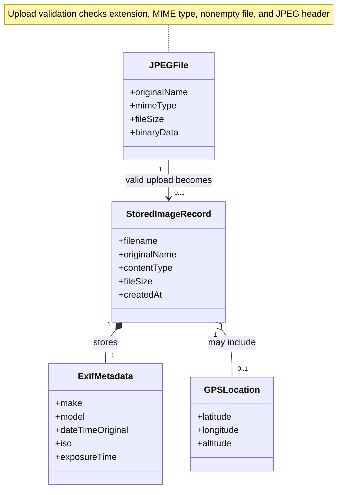

# JPEG Upload Validation (Conceptual Class Diagram)

This conceptual model describes the JPEG files, stored image records, extracted metadata, and optional GPS information involved in Calypso's image-upload workflow.

The concepts correspond to functionality in `src/DropZone.tsx`, `src/server/server.ts`, and `src/server/models/Image.ts`. They represent domain concepts, not necessarily separate TypeScript classes.

## Implementation correspondence

- `JPEGFile`: Uploaded file information received by the React frontend and Express server.
- `StoredImageRecord`: The document defined through the MongoDB image model.
- `ExifMetadata`: Information extracted using EXIFTool.
- `GPSLocation`: Optional location information extracted from JPEG metadata.

Invalid uploads are rejected before a stored image record is created.
