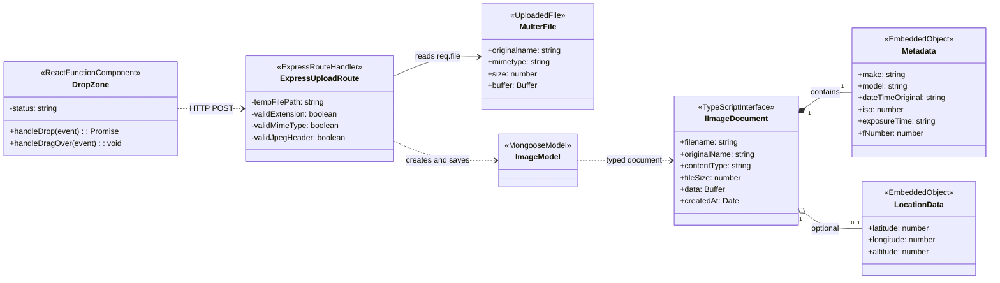

# JPEG Upload Validation (Detailed Design Diagram)

This UML class/type diagram represents the actual components, interfaces, and data structures involved in Calypso's JPEG upload validation workflow.

The implementation uses React functional components and an inline Express route handler rather than conventional classes. The diagram uses UML stereotypes to represent those constructs without implying that additional TypeScript classes have been implemented.

## Source Code Correspondence

| Diagram element | Actual implementation |
|---|---|
| DropZone | `src/DropZone.tsx` |
| ExpressUploadRoute | Inline POST handler in `src/server/server.ts` |
| MulterFile | `req.file` provided by Multer |
| IImageDocument | Interface in `src/server/models/Image.ts` |
| ImageModel | Mongoose model in `src/server/models/Image.ts` |
| Metadata | Embedded metadata object in the image record |
| LocationData | Optional location object in the image record |

The `DropZone` operations shown are local functions inside the React component. `ExpressUploadRoute` represents an inline route callback, and its listed values are local variables, not actual class instance fields.

Metadata and location fields are shown using their declared TypeScript types. Individual metadata properties and GPS fields may be absent.

## Validation Design

**Frontend validation — DropZone.tsx**
- Checks the JPEG filename extension.
- Checks the MIME type.
- Rejects empty files.
- Displays an error without sending invalid input to the server.

**Backend validation — server.ts**
- Checks the uploaded file extension and MIME type.
- Checks the first three bytes of the JPEG signature.
- Returns HTTP 400 for rejected uploads.
- Prevents rejected uploads from reaching EXIFTool or MongoDB storage.

The JPEG signature check is preliminary validation; it does not guarantee that the entire image is uncorrupted.
