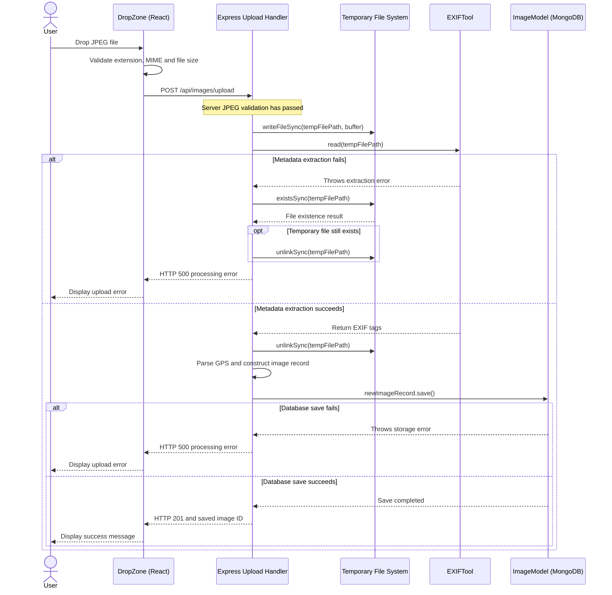

# JPEG Upload (Error Handling and Recovery Sequence Diagram)

This diagram represents Calypso's handling of metadata extraction and database storage failures after an uploaded JPEG has passed validation.

It documents the behavior of `src/DropZone.tsx` and `src/server/server.ts`, including temporary file cleanup, exception handling, and HTTP responses.

## Implementation Correspondence

| Behavior | Source |
|---|---|
| JPEG file submission and result messages | `src/DropZone.tsx` |
| Server-side validation and exception handling | `src/server/server.ts` |
| Temporary file creation and deletion | Node.js `fs` operations in `server.ts` |
| Metadata extraction | `exiftool.read()` |
| Database persistence | `newImageRecord.save()` |

## Design Considerations

- Validation occurs before temporary file creation.
- A metadata extraction failure prevents database storage.
- Temporary image files are deleted after successful metadata extraction.
- The server's exception handler attempts cleanup if a temporary file still exists.
- A database save failure produces HTTP 500 rather than a success response.
- Successful persistence produces HTTP 201 and returns the saved image ID.

This diagram models existing application behavior. It does not imply that separate error-handling service classes have been implemented.
